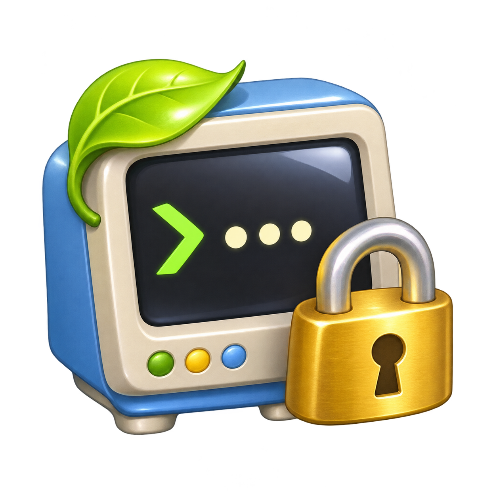

<p align="center">
  
</p>

# sshpass

`sshpass` supplies a password to OpenSSH and other terminal-based programs in
non-interactive scripts. This implementation uses POSIX pseudo-terminals and is
designed to build natively on Haiku without third-party libraries.

## Building on Haiku

```sh
make
make test
make install
```

The default destination is `/boot/system/non-packaged/bin/sshpass`, with its
manual page under `/boot/system/non-packaged/documentation/man/man1`. `PREFIX`,
`BINDIR`, `MANDIR`, and `DESTDIR` can be overridden when packaging.

## Usage

Prefer an environment variable, password file, or inherited descriptor over a
command-line password:

```sh
SSHPASS='secret' sshpass -e ssh user@example.com
sshpass -f ~/config/server.password ssh user@example.com
sshpass -d 3 ssh user@example.com 3< ~/config/server.password
```

For compatibility with the established utility, `-p`, `-f`, `-d`, `-e`, `-P`,
`-v`, `-h`, and `-V` are supported. See `man sshpass` after installation.

## Security

SSH keys are safer than stored passwords. In particular, avoid `-p` when
possible because command-line arguments may be observable by other processes.

# License

This project is licensed under the MIT License.
